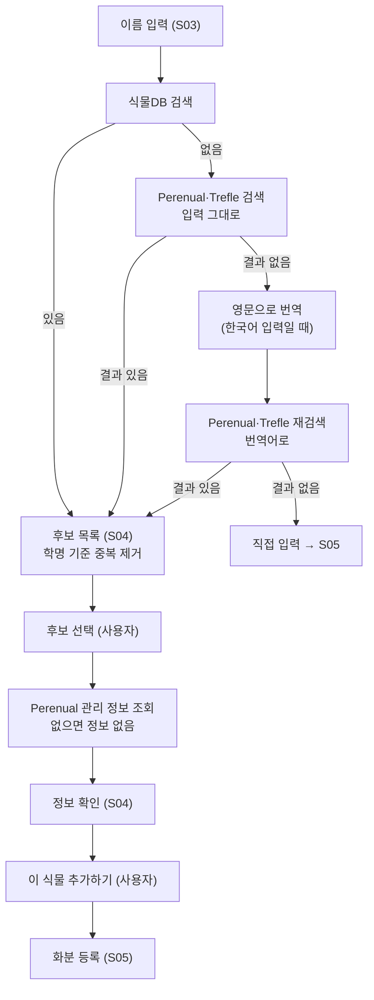
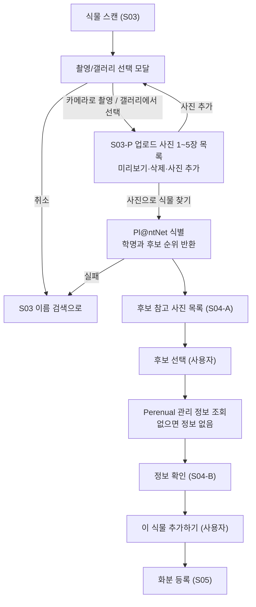

# 2단계 · 기능 상세 명세서 (Draft)

> **상태:** **승인됨 (2026-11-12, [ADR-0003](../decisions/ADR-0003-implementation-decisions.md) D1)** — 4단계 구현 기준. 미결정이던 항목은 ADR-0003에서 확정했다.  
> **기준 출처:** 병합된 PR #3 `docs/08-functional-review.md`, PR #4 `docs/reviews/claude/2026-11-09-stage1-feasibility.md`, PR #1의 `docs/01-requirements.md` / `docs/02-mvp-specification.md`.  
> **우선하는 사용자 확정:** 사용자 1명, 실내 식물 우선, F05 건강 점검 1차 필수, 종별 관리 정보의 '직접 입력하기' (사용자가 양식에 직접 입력, AI 호출 없음), 사용자 직접 최종 승인, 사진으로 정확도 검증.  
> **범위:** 사용자에게 보여줄 정보·입력·동작·예외·검증 기준. 코드/DB 스키마/호스팅 설정/테스트 수행은 포함하지 않는다.

## 1. 공통 요구

- 모든 기능은 **개인 사용자 1명**을 위한 것이다. 초대, 공동 관리, 타인과 공유하는 뷰는 1차 범위에서 제외한다.
- 개인 식물 사진과 기록은 비공개. 사진을 외부 분석 서비스로 보낼 때는 사용자가 목적과 전송 사실을 알 수 있어야 한다.
- 종은 '사용자가 확정한 이름', '모델이 제안한 후보', '종을 모름' 상태를 구별한다. 후보가 자동 확정되지 않는다.
- 관리 참조 정보는 종별로, 실제 관리 이력과 사진·관찰은 화분별로 다르게 저장된다는 **사용자 동작 규칙**을 지킨다.
- 식물 등록, 관리 기록은 외부 분석 장애/할당량 초과에도 가능한 것이 원칙이다.
- 중요한 삭제/보관/종별 관리 정보 검토 완료는 사용자가 직접 요청하고 확인한다.
- 화분을 표시할 때 이름은 **별명 → 한국어 이름 → 학명** 순으로 쓴다. 후보·종 정보 등 그 밖의 화면에서는 **한국어 이름 → 학명** 순으로 쓴다. 한국어 이름은 식물DB의 번역어이며, 없으면 번역을 요청해 식물DB에 저장한 뒤 쓰고, 번역이 실패하면 학명을 쓴다. 영문 일반명은 화면에 직접 쓰지 않는다 (`04-data-sources.md` 참고).
- 모든 상태 메시지는 한국어. '결과 확정'과 'AI가 추정한 가능성'을 혼동시키지 않는다.

## 2. F01 · 개인 접근 및 기록 보호 (S01/S12)

**입력/상태:** 미인증, 사용 가능, 세션 만료, 접근 불가.  
**행동:** 개인 사용자 접근, 로그아웃/접근 종료, 삭제/내보내기 관련 안내.  
**규칙:** 이용자는 한 명이며 공개 가입·초대·공동 관리 기능이 필요하지 않다. 사용자가 아닌 접근 시 사진/메모/화분 정보를 보여주지 않는다. 개인 데이터 삭제는 확인 절차를 요구한다.  
**예외:** 인증 오류 시 내용 표시 전 접근 복구 안내.  
**접근 방식:** Supabase Auth 이메일+비밀번호, 소유자 계정 1개, 공개 가입 끔. S01 외 모든 화면·API는 세션 필요(ADR-0003 D2).

## 3. F02–F04 · 사진 식별, 수동 검색, 종 확인 (S03/S04)

**시작 화면(S03) 필수:** 식물 추가에 들어오자마자 **이름 검색창**과 **'식물 스캔' 버튼**을 **동시에, 별도 전환 없이** 표시한다. 어느 쪽도 다른 쪽을 먼저 사용하도록 강제하지 않는다.

**입력:** 한국어 식물 이름·학명·품종명 검색어 **또는** 식물 사진 1–5장(카메라/갤러리), 직접 입력한 이름, 종 미상 선택. 사진은 JPEG·PNG·WebP, 원본 1장 15MB 이하, 업로드 전 긴 변 1600px로 축소, 서버에서 EXIF 제거(ADR-0003 D4).  
**동작:**
1. 사용자가 검색창에 한국어 일반명·학명·품종명을 입력하면 일치 후보를 확인할 수 있다. 검색은 Perenual과 Trefle을 사용한다 (`04-data-sources.md` 참고). 후보에는 확인 가능한 **한국어 이름(있을 때)·학명·품종명(있을 때)**을 표시한다. 사용자는 한 번만 입력하며, 검색 순서(식물DB → 입력 그대로 Perenual·Trefle → 한국어 입력이면 영문 번역 후 재조회)는 코드가 자동으로 처리한다.
2. 이름 검색 결과를 선택하면 **S04의 식물 정보 확인 단계**로 이동한다. 사진 선택·촬영은 필요하지 않으며, 검색 결과 선택만으로 화분이 추가되지 않는다.
3. S03에서 **[식물 스캔]**을 누르면 **촬영/갤러리 선택 모달**을 먼저 표시한다. 모달에서 [카메라로 촬영] 또는 [갤러리에서 선택]을 선택하면 **S03-P 업로드 사진 목록**으로 이동한다. S03-P는 사진 1~5장 미리보기·개별 삭제·[사진 추가]·**[사진으로 식물 찾기]**만 제공하며, 사진 추가는 촬영/갤러리 선택 모달을 다시 연다. [사진으로 식물 찾기] 클릭 시 Pl@ntNet 사진 식별을 요청하고 결과는 **S04-A** 후보 목록에 표시한다. **S03-P에는 별도 전송 동의 확인 화면이나 체크박스를 두지 않는다.**
4. **S04-A** 검색·스캔 후보에는 참고 사진(제공되면 표시, 없으면 '사진 없음') + 한국어 표기(가능할 때) + 학명 + 후보 순위를 보여주며, 식별 점수를 실제 확정 확률로 과장하지 않는다. **검색·스캔 모두 S04에서 후보 선택 → 간단한 식물 정보 확인 → 사용자의 '이 식물 추가하기' 결정**을 거친다.
5. 검색 결과가 없거나 모델 결과가 불확실하면 **이름 직접 입력 또는 '종을 모르겠어요'**를 선택해 등록을 계속한다. 오입력이나 별칭을 임의로 기존 종과 합치지 않는다.
6. **S04-B 식물 정보 미리보기:** 후보를 누르면 한국어 이름(있을 때), 학명/품종명(확인된 경우), 식물 사진(있는 경우), 짧은 소개 및 관리 난이도·빛 환경 등 **실제로 확보된 간단 정보**를 보여준다. 관리 정보가 비어 있으면 해당 항목은 '정보 없음'으로 표시하며 자동 AI 생성은 금지한다. 사용자가 **'이 식물 추가하기'**를 눌러야 **S05 개별 화분 등록**으로 이동하고, '다른 식물 찾기'로 검색/후보 목록으로 돌아갈 수 있다. 식물 정보 미리보기나 '이 식물 추가하기'만으로 실제 화분이 저장되지 않는다.
7. 초기 종별 관리 DB는 **0건**이다. 검색할 때마다 검색 결과가 식물DB에 쌓인다. 첨부된 참고 화면의 '인기 식물' 목록은 **초기 데이터로 임의 등록하지 않는다**. 향후 목록을 보일 때는 실제 데이터 제공 가능 여부와 출처를 먼저 정하고, 결과가 없으면 빈 상태를 표시한다. 검색 데이터 제공 주체는 Perenual과 Trefle로 정해졌다 (`04-data-sources.md` 참고). 인기 목록은 MVP에서 보여주지 않는다. 같은 종 판정은 정규화한 학명의 완전 일치만 쓰고 별칭은 자동 연결하지 않는다(ADR-0003 D10·D11).

**오류:** 검색 후보 없음·네트워크 단절·카메라 거부·사진 파일 오류·스캔 API 실패/무료 한도 → **같은 초기 S03 화면에서 검색과 스캔을 서로 대체**할 수 있고, 어느 경우에도 수동 입력·미상 등록이 가능해야 한다. 검색 한도를 초과하면 '오늘은 식물 검색을 더 이상 이용할 수 없습니다. 내일 다시 시도해 주세요.' 문구를 보여준다.  
**완료 기준:** 진입 즉시 이름 검색과 사진 스캔 둘 다 실행 가능하고, 어느 경로든 **검색 성공 → 간단 정보 표시 → 사용자 '이 식물 추가하기' 선택 → S05 화분 정보 입력 및 저장**으로 이어진다. 정보를 본 뒤 추가하지 않고 되돌아갈 수 있다.

### 식별 흐름 (F02–F04)

이름 검색과 사진 식별은 후보를 찾는 방법만 다르고, 후보 선택 이후는 같습니다. API 사용처는 `04-data-sources.md`를 따릅니다.

**이름 검색**

**사진 식별**

## 4. F05 · 사진 기반 건강 점검 **1차 필수** (S07)

**기능 목표:** 사진과 사용자가 입력한 관찰을 근거로 증상을 정리하고 *가능한 원인* 및 안전한 추가 확인 항목을 제안. **병명이나 원인을 확정 진단하지 않는다.**

**사용 API:** Pl@ntNet 질병 식별 (`POST /v2/diseases/identify`). 결과는 '가능한 원인 후보'로만 표시한다 (`04-data-sources.md` 참고).

### 입력과 필수/선택 구분
| 입력 | 필수 | 규칙 |
|---|---|---|
| 증상 사진 | 필수 | 최소 1장. 무관한 사진/품질 불량은 재촬영 안내 |
| 대상 화분 | 선택 | 미등록 사진도 점검 가능; 저장할 때는 연결할 화분 필요 |
| 이미 확인한 종 이름 | 선택 | 없다면 '종을 모르겠음'으로 가능; 정확도 한계 표시 |
| 관찰 증상 | 선택 | 반점/갈변/시듦/벌레/기타, 여러 항목 가능 |
| 발견 시점·최근 관리 | 선택 | 기억나지 않으면 비워 둘 수 있음 |
| 외부 사진 전송 확인 | 해당 전송에 필수 | 전송 버튼 위 한 줄 안내, 버튼을 누르는 것이 전송 선택. 별도 체크박스 없음. 누르지 않으면 외부 요청 **미실행**; 일반 관찰 기록으로 이동 가능 (ADR-0003 D5) |

### 결과의 구조
| 표시 요소 | 필수 여부 | 내용 |
|---|---|---|
| 사진에서 관찰한 징후 | 필수 | 관찰과 추론을 구분하여 설명 |
| 가능한 원인 | 가능한 경우 | 우선 확인할 후보 1~3개; 근거 부족하면 '판단 어려움' |
| 추가 확인 질문/항목 | 필수 | 흙 상태, 최근 물주기, 잎 뒷면 등 사용자가 직접 확인할 수 있는 사항 |
| 안전한 다음 행동 | 가능한 경우 | 점검/관찰 중심. 약제·처치가 반드시 필요하다고 단정하지 않음 |
| 불확실성/제한 | 필수 | '사진만으로 확정할 수 없음', 모델 분석·생성 날짜 등 |
| 저장/재점검 | 선택 | 등록 화분에 결과를 저장하거나 추가 사진으로 다시 확인 |

**실패 및 보호 동작:** 분석 실패/쿼터 소진/전송 거절/응답 없음 → 사진/관찰 설명이 사라지지 않아야 하며, 다시 시도/관찰만 기록/화분 등록 경로를 제공한다. 실제 사용자는 결과가 잘못될 수 있음을 확인하고 최종 결정한다.

### 정확도 검증 **출시 필수 관문** — 사용자 수치 확정(2026-11-11)
- **사전 정의:** 사용자의 실제 실내 식물 사진을 중심으로, 건강/이상 상태와 증상 유형이 다른 샘플을 수집한다. 야외 사진은 보조 확인. 사진은 public GitHub 저장소에 올리지 않는다.
- **정답 근거:** 단순한 AI 응답과 사용자 추측만으로 '정답'을 확정하지 않는다. 관찰 경과, 반복 사진, 신뢰할 수 있는 원예 지식 또는 전문가 확인 등으로 충분한 근거가 있는 사례와 **원인 불명** 사례를 분리한다.
- **측정 지표 후보:** (a) 원인 판단이 가능한 사례에서 올바른 원인이 상위 3개 후보에 포함된 비율, (b) 확정 표현·위험한 조치 제안 발생 수, (c) 불확실한 사례를 불확실하다고 안내한 비율, (d) 기술적 성공률/실패 복구.
- **정량 기준 (사용자 지정, 2026-11-11):** 수집 사례 **최소 100건**(판정 불가 사례 포함). 판정 불가 사례는 **전체의 20% 이하**여야 한다. 판정 가능한 사례에서 원인 후보 상위 3개 포함률은 **80% 이상**이고 95% 신뢰구간 하한은 **70% 이상**이어야 한다. 명백히 위험한 조치 권고는 **0건**이어야 한다. 판정 불가 사례는 제외하지 않고 별도 수와 비율로 함께 보고한다. 이는 현재 성능 보증이 아니라 출시 판정 기준이다.
- **결과:** 승인된 기준을 충족하지 못하면 **F05 포함 1차 출시 판정을 통과하지 못함**. 임의로 필수 범위에서 제외하거나 정확도 수준을 달성했다고 주장하지 않는다.

## 5. F06–F07 · 화분 등록과 관리 (S05/S06/S11)

**입력:** 화분 별명(선택, 비워두면 식물 이름 표시), 종(확정/수동 이름/미상 가능), 실내·실외, 장소(선택), 사진(선택), 메모(선택). **등록 시 초기 관리 상태 입력 영역을 항상 제공한다.**

| 초기 관리 항목 | 입력 옵션 (사용자 지정) | 의미 및 처리 |
|---|---|---|
| **마지막 물 준 시기** | **당일 ~ 1일 전 / 일주일 전 / 한달 전 / 모름** | 등록 시점 기준 경과 기간을 **범주 그대로** 저장. 정확한 날짜·시간은 추측하지 않음. 첫 할 일 계산에만 범주 하한을 씀(ADR-0003 D16) |
| **빛이 들어오는 정도** | **직사광선 / 밝은 간접광 / 보통 / 약함 / 잘 모르겠음** | 화분별 현재 채광 환경으로 저장하며 추후 수정 가능 |
| **마지막 분갈이 시기** | [05 검토본](05-pc-mo-wireframe-snapshot.md) 규칙 1의 10개 구간(모름·한 적 없음 포함) | 등록 시점 기준 기간 범주를 그대로 저장. 미확인 날짜를 실제 분갈이 작업 시각으로 추정하지 않음 |
| **화분의 재질** | **플라스틱 / 테라코다,도기 / 유리 / 자기,석기 세라믹 / 화단** | 해당 화분의 재질/형태 정보로 저장. 사용자가 제시한 옵션 명칭 유지 |
| **알림 설정** | **물 알림 / 비료 알림** 각각 사용 여부 선택 | 화분별 두 알림의 활성/비활성 선택. API에 해당 데이터가 없으면 항목을 숨김. 일정은 ADR-0003 D16, 푸시는 MVP 제외 |

**행동:** 화분을 등록할 때 위 다섯 항목의 입력 영역을 함께 제공한다. 기간 선택은 **정확한 달력 날짜가 아닌 경과 시기 선택**이므로, 선택한 값을 임의의 과거 날짜로 환산하거나 실제 물주기/분갈이 이력을 자동 작성하지 않는다. 범주를 선택한 시점(등록 기준)을 함께 유지하여 나중에 '일주일 전'이라는 기록의 의미가 바뀌지 않도록 한다. 채광·재질·알림은 화분별 설정으로 저장하며, 같은 종의 다른 화분에 자동 복사하지 않는다. **별명을 비우면 한국어 식물 이름, 없으면 학명을 표시한다(표시 순서는 1절 참고). 빈 별명 필드를 자동 생성·저장하지 않는다. 모바일 S05는 하나의 긴 스크롤 화면이다.** 별명/장소/환경/알림 수정과 화분 보관·복원은 계속 지원한다.  
**오류/빈 상태:** 별명 미입력 허용 및 식물 이름 표시, 사진 없이 등록 가능, 종 식별 실패 또는 외부 분석 불능과 무관하게 등록 가능. 알림을 끄더라도 사용자가 직접 관리 활동을 기록할 수 있으며, 시기 항목을 실제 수행한 날짜로 오해하지 않게 표시한다.  
**확정된 세부 사항:** 분갈이 구간, 알림 노출 조건, 보관·복원·영구 삭제의 차이는 [05 검토본](05-pc-mo-wireframe-snapshot.md) 규칙 1·2·4를, 알림 일정 계산은 ADR-0003 D16을 따른다.

## 6. F10 · 종별 관리 정보 및 추천 (S06/S13)

**입력:** 사용자가 확인한 종 또는 신뢰할 수 있는 수동 종 정보, 필요 시 실제 화분 관찰/환경.  
**동작:**
1. 확인된 종에 저장된 관리 정보가 있으면 재사용한다.
2. 없으면 기본 상태는 '관리 정보 없음'이며 **자동 생성하지 않는다**. 관리 정보는 Perenual에서 조회한다 (`04-data-sources.md` 참고).
3. 사용자가 **'직접 입력하기'**를 누르면 빛·물·온도·흙·주의사항 등을 작성할 수 있는 **빈 입력 양식**을 연다. 해당 동작에서는 AI 생성 요청을 하지 않는다.
4. 저장하는 정보는 항목별로 `직접 입력` 출처로 구분하고, 입력일·수정일·참고 자료(선택)를 확인할 수 있게 한다. API 값을 덮어쓰지 않는다. '검증됨'이라고 표시하지 않는다.
5. 저장 전 미리보기에서 사용자가 [저장]을 누르는 것을 **검토 완료**로 본다. 화면 표기는 '직접 입력(사용자 확인)'. 직접 입력한 값으로는 알림을 만들지 않는다(ADR-0003 D13). 입력하지 않아도 화분 등록과 개인 기록은 계속 가능.
6. 같은 종의 다른 화분에는 이미 저장된 종별 관리 내용을 재사용한다. 화분별 추천은 그 화분의 실제 환경·기록을 따로 반영한다.

**추천 원칙:** 흙을 확인하는 알림과 실제 물주기를 구분. 확정적으로 '매주 월요일 물을 주라'고 안내하지 않으며 계절/상태/최근 관리가 없으면 보수적으로 점검을 제안한다.  
**실패:** 입력 취소 시 '관리 정보 없음'을 유지한다. 저장 실패·오프라인 시 입력 내용을 보존하고 다시 저장할 수 있도록 안내한다. 직접 입력 동작에는 외부 AI 호출이나 무료 한도 문제가 없다.  
**확정:** 같은 종 판정은 정규화 학명 완전 일치만(ADR-0003 D10). 같은 항목에 API 값과 직접 입력 값이 모두 있으면 둘 다 출처와 함께 보여준다. 편집 이력은 수정일만 남긴다.

## 7. F08–F09 · 관리/관찰 기록 (S08)

**사용자 확정 입력 방식:** 관리 행동을 먼저 선택해 화면을 전환하지 않는다. **실제 물주기·비료·분갈이·가지치기·흙 상태·잎/해충/환경 관찰·사진/메모를 한 화면에 함께 표시**하고, 필요한 항목만 선택적으로 작성한다. 공통 기록 날짜/시간은 확인·수정할 수 있다.

| 선택 입력 항목 | 기록 규칙 |
|---|---|
| 실제 물주기 | 실제로 물을 준 경우에만 체크하며 양·메모는 선택. 물주기 로그는 1회 생성 |
| 비료/분갈이/가지치기 | 각각 실제 수행한 경우에만 선택. 입력한 유형만 활동 로그 생성 |
| 흙 상태 확인 | 마름/적당/젖음/잘 모르겠음. 입력 시 관찰만 기록하고 급수 로그 생성 금지 |
| 잎·해충·환경 관찰 | 관찰 내용 입력 시에만 해당 화분의 관찰 기록 생성 |
| 사진·메모 | 선택 항목이며 해당 화분의 활동/관찰 이력에 연결 |

**저장:** 입력·선택한 항목만 개별 이력으로 기록한다. 아무 항목도 입력하지 않은 빈 제출은 저장하지 않는다. 여러 행동을 한 번에 입력해도 중복 제출·중복 로그를 방지한다. 저장 실패 시 작성 중인 입력을 유지한다.

## 8. F11 · 관리할 일 (S02/S09)

**상태:** 예정/기한 지남/완료/미루기/건너뛰기. 개별 완료·미루기·건너뛰기 동작은 계속 제공한다.

**사용자 확정 다중 선택:**
- **PC**는 관리할 일 행마다 체크박스를 **항상 노출**한다. 여러 할 일을 선택하고 [선택 완료]/[선택 미루기]/[선택 건너뛰기]로 한 번에 변경한다.
- **모바일**은 목록 상단 **[상태 한 번에 바꾸기]**를 누르면 체크박스 선택 모드로 들어간다. 선택 모드에는 상태 변경 버튼과 [취소]가 있다. 기본 목록에서는 개별 변경이 가능하다.
- 선택한 항목이 없으면 일괄 실행할 수 없으며, **선택한 항목만** 상태가 변경된다. 부분 실패 시 성공·실패 항목을 구분해 안내한다.

**행동·안전 규칙:** '흙 상태 확인' 완료는 관찰이지 실제 급수가 아니다. '물 주기' 완료는 실제 수행 여부를 확인한 경우에만 물주기 이력을 한 번 생성하며, **일괄 완료도 예외가 아니다**. 미루기·건너뛰기·기한 경과로 실제 활동 로그를 만들지 않는다. 다음 점검 날짜 계산은 ADR-0003 D16을 따른다.

## 9. F12 · 사진·관찰/활동 타임라인 (S10)

한 화분 안에서 사진, 사용자 관찰, 물주기, 비료 등 실제 활동, 건강 점검(사용자가 저장한 경우)을 시간순으로 표시. 날짜/행위 유형으로 필터 가능하게 제안. 누락된 사진이나 삭제된 기록은 분명히 표시하고 **다른 화분의 개인 기록과 섞지 않는다**.

## 10. F13 · 사이트 내 알림 (S02/S09)

사이트를 **열고 있는 동안** 예정/기한 지남 관리 작업을 확인하는 기능. S05에서 각 화분의 **물 알림**과 **비료 알림**을 독립적으로 켜고 끌 수 있으며, 해제된 유형의 알림은 표시하지 않는다. 알림 노출 조건은 05 검토본 규칙 2, 일정 산출은 ADR-0003 D16을 따른다. 브라우저 밖 푸시 알림은 P1(F14)이며 등록 화면의 알림 선택만으로 푸시 동의를 받았다고 간주하지 않는다. 알림이 없는 경우 빈 상태를 분명히 보여준다.

## 11. 화면별 기능·예외 대응

| 화면 | 필수 동작 | 실패/빈 상태 |
|---|---|---|
| S01 개인 진입 | 사용자 접근 상태 구분 | 세션 만료 안내, 비공개 데이터 노출 금지 |
| S02 오늘 | 오늘 할 일과 건강 점검 진입 | 화분/할 일 없음 |
| S03/S03-P 식물 추가 | S03의 이름 검색창과 [식물 스캔] 동시 노출; 스캔 클릭 시 촬영/갤러리 선택 모달 → S03-P 업로드 사진 목록·삭제·추가 → [사진으로 식물 찾기] → S04-A | 검색 결과 없음·사진·권한·전송 장애 시 서로 전환 및 직접 입력. 검색 한도 초과 시 '오늘은 식물 검색을 더 이상 이용할 수 없습니다. 내일 다시 시도해 주세요.' 표시 |
| S04-A/S04-B 식물 정보 확인 | 참고 사진(있으면)·이름·학명 후보 목록을 확인하고 후보 선택 뒤 사진(있으면)·이름·학명·기본 정보 요약을 보여주고 '이 식물 추가하기' 또는 '다른 식물 찾기' 선택 | 기본 정보 부재 시 '정보 없음', 잘못된 후보/종 미상 시 되돌아가기 |
| S05 등록 | 화분 별명(선택), 최근 물 준 시기·채광 정도·분갈이 시기·재질·물/비료 알림을 선택해 등록 | 시기는 기간 선택값으로 유지(임의 날짜 생성 금지), 종 정보 없음·API 장애여도 등록 |
| S06 화분 상세 | 종 정보와 개인 이력 분리, 관리 시작 | 관리 참조 정보 없음 |
| S07 건강 점검 | 사진·관찰 입력, 외부 전송 확인, 결과 확인 | 결과 불확실·한도 초과·응답 없음 |
| S08 기록 | 행동 사전 선택 없이 통합 양식에서 필요한 항목만 입력하고 실제 행위·관찰을 분리 저장 | 중복·오프라인·저장 실패 |
| S09 관리할 일 | 확인/완료/미루기/건너뛰기 및 PC·MO 다중 선택 후 일괄 상태 변경 | 할 일 없음·동기화 오류 |
| S10 이력 | 화분별 사진/기록 검색 | 기록 없음·사진 표시 실패 |
| S11 식물 목록 | 검색/필터/신규 등록 | 첫 사용/검색 결과 없음 |
| S12 더보기 | 개인 설정·개인정보 안내 | 설정 미입력·데이터 삭제 확인 |
| S13 관리 정보 | 자료 조회, '직접 입력하기'로 양식 열기, 입력·미리보기·저장 | 자료 없음·저장 실패 |

## 12. 주요 기능 인수 시나리오 (5단계 테스트의 기준 초안)

- [ ] **T01** 개인 사용자만 개인 사진/관찰/화분 기록 열람 가능.
- [ ] **T02** 식물 추가(S03)에 진입하면 **한국어/학명/품종명 검색과 사진 스캔이 동시에 보이며**, 검색만으로 식물을 선택해 S04→S05 등록 가능.
- [ ] **T02a** 사진 스캔을 선택하면 S03 촬영/갤러리 선택 모달 → S03-P 사진 목록 → [사진으로 식물 찾기] → S04-A 후보 확인 → S04-B 종 정보 확인 → S05 등록으로 진행 가능. 검색을 먼저 할 필요 없음.
- [ ] **T02b** 초기 종별 관리 DB에 미리 채운 인기 식물 정보가 없어도, 검색 데이터가 없을 때 빈 상태와 직접 입력·종 미상 등록이 가능.
- [ ] **T02c** 이름 검색 또는 스캔의 후보 선택 시 식물 사진(있으면), 이름·학명과 검증 가능한 간단 정보가 먼저 표시되며, **'이 식물 추가하기'**를 눌러야만 S05로 이동. '다른 식물 찾기'로 검색/후보로 복귀 가능.
- [ ] **T02d** 조회 가능한 기본 정보가 없는 종은 없는 내용을 생성하지 않고 '정보 없음'으로 표시. 미리보기/S05 진입만으로 화분이 저장되지 않으며 S05의 최종 등록 후 저장.
- [ ] **T02e** S03에서 촬영/갤러리 선택 모달을 열고 S03-P에서는 사진 1~5장 미리보기·삭제·추가만 수행한 뒤 [사진으로 식물 찾기]를 눌러 S04-A의 참고 사진이 있는 후보 목록을 확인. S03-P에 별도 전송 동의 확인 단계가 없음.
- [ ] **T03** 사진 인식 실패·권한 거부 시 **초기 이름 검색으로 돌아갈 수 있고**, 이름 입력 또는 종 미상 등록 가능.
- [ ] **T03z** 화분 별명 없이 등록 가능하고 식물 이름을 대신 표시하며 모바일은 단일 스크롤 등록 화면임.
- [ ] **T03a** 화분 등록에서 마지막 물 준 시기(당일 ~ 1일 전 / 일주일 전 / 한달 전 / 모름), 채광(직사광선 / 밝은 간접광 / 보통 / 약함 / 잘 모르겠음), 마지막 분갈이 시기(당일 ~ 1일 전 / 일주일 전 / 한달 전 / 2~3개월 / 3-6개월 / 6개월 이상 / 1년 이상)를 제시.
- [ ] **T03b** 선택한 시기 범주는 해당 화분의 초기 관리 정보로 저장하며, 정확하지 않은 날짜를 생성하거나 실제 작업 이력으로 자동 기록하지 않음.
- [ ] **T03c** 화분 재질(플라스틱 / 테라코다,도기 / 유리 / 자기,석기 세라믹 / 화단)을 선택하고 화분별로 저장.
- [ ] **T03d** 물 알림과 비료 알림의 사용 여부를 각 화분에서 독립적으로 선택·수정하고, 꺼진 알림 유형은 표시하지 않음.
- [ ] **T04** 신규 종에 관리 정보가 없으면 자동 생성 없이 '직접 입력하기'를 표시.
- [ ] **T05** 버튼을 누르면 비어 있는 관리 정보 입력 양식이 열리고 AI 호출 없이 입력·저장·사용자 검토 완료 승인 가능.
- [ ] **T06** 동일 종의 다른 화분은 관리 정보를 재사용하되 화분별 기록은 분리.
- [ ] **T07** 건강 점검 결과는 증상/가능 원인/추가 관찰/불확실성을 포함하고 확정 진단 금지.
- [ ] **T08** 건강 점검의 사진 전송 거부/장애/한도 초과에도 수동 관찰과 화분 등록 가능.
- [ ] **T09** 흙 상태 확인 완료는 자동 급수 기록을 만들지 않음.
- [ ] **T10** 물주기 실제 완료를 기록하면 중복 저장되지 않음.
- [ ] **T10a** S08 한 화면에서 여러 선택 입력을 한 번에 저장할 수 있고 입력하지 않은 활동은 기록하지 않음.
- [ ] **T10b** S09 PC 체크박스 상시/모바일 선택 모드에서 여러 항목을 일괄 상태 변경하고, 급수 수행 여부를 따로 확인하며 부분 실패를 안내함.
- [ ] **T11** 사이트에 접속했을 때 예정 작업을 확인하고 미루기/건너뛰기 가능.
- [ ] **T12** 근거 있는 실제 사진 테스트에서 **사용자가 3단계에 승인한 F05 정확도 기준**을 충족해야 첫 출시 가능.

이는 **테스트 실행 기록이 아닌 명세 초안**이다. 실제 구현 후 검증은 5단계에서 진행한다.

## 13. 쟁점별 확정 결과 (2026-11-12, ADR-0003)

| 항목 | 확정 내용 |
|---|---|
| F05 평가 기준 | 수집 사례 최소 100건, 판정 불가 20% 이하, 판정 가능 사례 Top-3 80% 이상(95% 하한 70% 이상), 위험 조치 0건. 사용자 지정(2026-11-11) |
| **F05 건강 점검** 사진 전송 동의 | S03-P·S07 모두 별도 동의 화면 없음. 전송 버튼 위 한 줄 안내, S12에 상세 안내. 미연결 사진은 24시간 뒤 삭제, 제공자 원본 응답 미저장 (ADR-0003 D5·D6) |
| 이름 검색 / 인기 목록 | 일반명·학명·품종명 검색을 첫 화면에 노출(확정). 검색 데이터 출처는 Perenual·Trefle로 확정. 매칭은 식물DB 부분 일치, 인기/추천 목록은 MVP 미노출; 초기 0종 데이터 원칙 유지 (ADR-0003 D10·D11) |
| 수동 종 등록 | '종 미상' 허용, 입력한 이름을 그대로 보존. 자동 학명 연결 없음, S06에서 나중에 연결 가능 (ADR-0003 D12) |
| 같은 종 판정 | 정규화 학명 완전 일치만. 별칭·오탈자·종 미상은 자동으로 합치지 않음 (ADR-0003 D10) |
| 초기 관리 입력 선택값 | 분갈이 10개 구간과 알림 노출 조건은 05 검토본 규칙 1·2, 알림 일정은 ADR-0003 D16 |
| 관리 정보 직접 입력 | AI 호출 없음. 미리보기 후 [저장]이 검토 완료. 직접 입력 값으로 알림 생성 안 함 (ADR-0003 D13) |
| 화면 탐색 | 모바일 하단 4개 탭, PC 왼쪽 세로 메뉴, S13 별도 화면 (ADR-0003 D15·D13) |
| 지원 식물 | 모든 식물 등록 가능, 용어는 실내 기준. 관리 정보가 없으면 안내와 직접 입력 제공 (ADR-0003 D14) |
| 사진 형식·용량 | 1–5장, JPEG·PNG·WebP, 원본 15MB 이하, 긴 변 1600px, 서버 EXIF 제거 (ADR-0003 D4) |
| 한국어 이름 검색 연결 | 확정: 식물DB 검색 → 없으면 입력 그대로 Perenual·Trefle 조회 → 결과가 없고 한국어 입력이면 영문으로 번역해 재조회 → 그래도 없으면 직접 입력 (`04-data-sources.md`) |

### 명확한 단계 경계

- **2단계:** 정보 구조·와이어프레임·기능서 제작 (완료).
- **3단계:** 검토/수정, 사용자 승인 (2026-11-12 ADR-0003으로 완료).
- **현재 4단계:** 코드 개발.
- **5단계:** 실제 테스트 배포 및 정의서 기준 검증.
- **6단계:** 수정 후 최종 배포.

이 문서는 5단계의 실제 테스트 결과를 포함하지 않는다.
