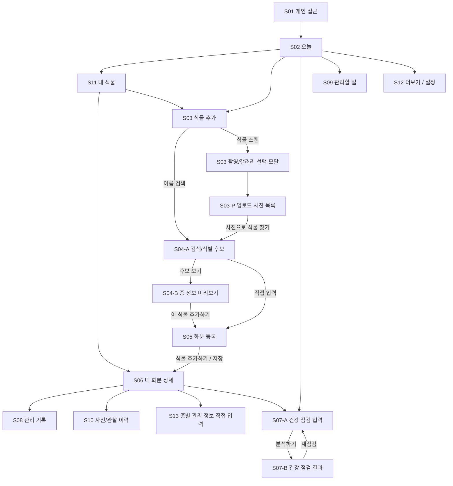

# Die No More — PC / 모바일 와이어프레임 검토본

> **기준 원본:** `die_no_more_wireframes_s09_toolbar_updated.pptx` (39페이지)  
> **원본 SHA-256:** `9b52aab6bc6d6f3530918b11450f00d5d0f3c4dbed29747cafbf5c887b36f711`  
> **PDF SHA-256:** `dcf3ec6c8210a4dcde78b981fccb978023ff1ff28b3ff29fe8423031f77fbacb`  
> **범위:** 2단계 화면 설계. 흑백 구조 와이어프레임이며 디자인·코드·배포 아님.
>
> **파일 형식 주의:** 이 GitHub 파일은 현재 39페이지 PPTX의 **화면별 텍스트 검토본**입니다. 원본 PPTX·PDF 바이너리는 GitHub PR에 첨부되지 않았으며 원본 자체를 대체하지 않습니다. 원본은 ChatGPT 대화의 산출물에서 확인합니다.
>
> 표시된 식물명/관리 기록은 배치 예시로 실제 사용자 데이터가 아닙니다. 기존 와이어프레임을 새로 디자인하거나 수정하지 않았습니다.

## 전체 이동 구조 — 2페이지



**화면 범위:** S01~S13을 기반으로 S03 촬영 모달, S03-P, S04-A/B, S07-A/B, S09 모바일 선택 모드를 구분합니다. **캘린더, 월간 통계, 자동 AI 관리 초안은 제외**됩니다.

## PC/MO 화면별 원본 내용

| 페이지 | 환경 | 화면 | 표시 항목·주요 조작 |
|---:|---|---|---|
| 1 | 공통 | 표지 | PC / MO 흑백 기능 기반 와이어프레임. 기존 기능만 표시 |
| 2 | 공통 | 전체 이동 구조 | S01–S13 화면 연결, 이름 검색과 사진 스캔 병렬 진입 |
| 3 | PC | S01 개인 접근 | 로그인, 비밀번호, [확인]→S02, 오류 안내 |
| 4 | MO | S01 개인 접근 | 로그인, 비밀번호, [확인]→S02, 오류 안내 |
| 5 | PC | S02 홈 | 오늘 할 일, 바로가기, 최근 기록, 할 일 상태 5종, [전체 보기]→S09 |
| 6 | MO | S02 홈 | 오늘 할 일, [전체 보기]→S09, 식물 등록→S03, 건강 점검→S07-A, 최근 관찰 |
| 7 | PC | S03 식물 추가 | 이름·학명·품종명 검색→S04-A, [식물 스캔]→선택 모달, 데이터 있는 경우에만 인기 목록 |
| 8 | MO | S03 식물 추가 | 이름 검색→S04-A와 [식물 스캔]→선택 모달 동시 표시 |
| 9 | PC | S03 스캔 선택 모달 | [카메라로 촬영]→S03-P, [갤러리에서 선택]→S03-P, [취소]→S03 |
| 10 | MO | S03 스캔 선택 모달 | 촬영/갤러리 선택 후 S03-P, 취소하면 S03 |
| 11 | PC | S03-P 사진 목록 | 업로드 사진 1~5장 미리보기, 개별 삭제, [+ 사진 추가]→선택 모달, [사진으로 식물 찾기]→S04-A |
| 12 | MO | S03-P 사진 목록 | 업로드 사진 미리보기, 개별 삭제, [+ 사진 추가]→선택 모달, [사진으로 식물 찾기]→S04-A |
| 13 | PC | S04-A 후보 목록 | 후보 3개 예시, 참고 사진/사진 없음, 이름·학명, [보기]→S04-B, [직접 입력]→S05, [다시 검색]→S03 |
| 14 | MO | S04-A 후보 목록 | 사진 있는 후보와 사진 없는 후보, [보기]→S04-B, [직접 입력]→S05, [다시 검색]→S03 |
| 15 | PC | S04-B 종 정보 | 사진·이름·학명/품종, 확보된 난이도/빛/물 정보·Perenual 출처, [이 식물 추가하기]→S05 |
| 16 | MO | S04-B 종 정보 | 사진·이름·학명·참고 정보, [이 식물 추가하기]→S05, [다시 검색]→S03 |
| 17 | PC | S05 화분 등록 | 사진·별명(선택)·장소·메모·초기 관리 환경·물/비료 알림, [식물 추가하기] 저장→S06 |
| 18 | MO | S05 화분 등록 | 기본 정보부터 초기 관리 환경까지 **단일 스크롤**. 별명 미입력 허용. [식물 추가하기]→S06 |
| 19 | PC | S06 화분 상세 | 사진·별명(없으면 이름)·환경·최근 물/분갈이/재질·종별 정보, 기록→S08, 이력→S10, 건강→S07-A, 직접 입력→S13 |
| 20 | MO | S06 화분 상세 | 사진·이름/별명·빛·물·분갈이/재질, 관리 기록→S08, 건강→S07-A, 종 정보→S13 |
| 21 | PC | S07-A 건강 점검 입력 | 증상 사진·대상 화분(선택)·증상·발견 시점, **건강 분석 외부 사진 전송 동의**, 분석→S07-B, 관찰만 기록→S08 |
| 22 | MO | S07-A 건강 점검 입력 | 사진 촬영/선택·대상 화분·관찰 증상·건강 분석용 전송 동의, 분석→S07-B, 관찰 기록→S08 |
| 23 | PC | S07-B 건강 점검 결과 | 사용 사진·관찰 징후·가능 원인·추가 확인, 판단 어려움·불확실성, 결과 저장→화분 이력, 재점검→S07-A |
| 24 | MO | S07-B 건강 점검 결과 | 사진·증상·원인 후보·확인 항목, 결과 저장→S10 이력, 재점검→S07-A |
| 25 | PC | S08 통합 관리 기록 | 실제 물주기·비료·분갈이·가지치기·흙·관찰·사진/메모 모두 **선택 입력**, [기록 저장]→S06 |
| 26 | MO | S08 통합 관리 기록 | 모든 활동 한 화면 스크롤, 수행 시각·흙 상태·관찰/사진/메모 선택, 저장→S06 |
| 27 | PC | S09 관리할 일 | 체크박스 상시, **[전체 선택] 옆에 [선택 완료]·[선택 미루기]·[선택 건너뛰기] 같은 상단 행**, 개별 처리 버튼 유지 |
| 28 | MO | S09 기본 목록 | [상태 한 번에 바꾸기]→S09 선택 모드, 평상시 개별 완료/미루기/건너뛰기 |
| 29 | MO | S09 일괄 선택 모드 | [전체 선택], 행 체크박스, 선택 완료/미루기/건너뛰기, [취소]→기본 목록 |
| 30 | PC | S10 사진·관찰 이력 | 날짜/유형 필터, 화분별 사진·활동·관찰 시간순, 상세→S10 내부 |
| 31 | MO | S10 사진·관찰 이력 | 날짜/유형 필터, 화분별 사진·관찰·급수 기록, 뒤로→S06 |
| 32 | PC | S11 내 식물 목록 | 이름 검색·상태 필터·정렬·화분 카드→S06, [새 식물 등록]→S03 |
| 33 | MO | S11 내 식물 목록 | 화분 검색·필터·사진 목록, [새 식물 등록]→S03, 화분 선택→S06 |
| 34 | PC | S12 더보기 | 계정·알림·내보내기·사진/기록 관리·외부 서비스 안내·삭제 안내. S12 내부 상세 |
| 35 | MO | S12 더보기 | 계정·알림·전송 안내·데이터 관리·삭제 안내. S12 내부 상세 |
| 36 | PC | S13 종별 관리 정보 | Perenual 출처·조회일, [직접 입력하기]→빈 양식, 빛/물/온도/흙/주의사항, 저장·검토 완료 |
| 37 | MO | S13 종별 관리 정보 | 종별 참고/미검토 상태, 직접 입력, 사용자 저장/검토 완료. 뒤로→S06 |
| 38 | 공통 | S05 상세 선택지 | 마지막 물 준 시기·채광·분갈이·화분 재질·물/비료 알림 실제 선택지 |
| 39 | 공통 | 오류·빈 상태 | 검색 결과 없음, 한도 초과, 사진 오류, 건강 점검 불확실, 전송 거절, 저장 실패, 접근 제한 |

## 주요 조작의 현재 확정 배치

### S03 → S03-P → S04-A (9~14페이지)

```text
S03 [식물 스캔]
  └─ 촬영/갤러리 선택 모달
       ├─ [카메라로 촬영] ───────┐
       └─ [갤러리에서 선택] ────┤
                               ▼
S03-P 업로드한 사진 목록 (1~5장)
       [사진 삭제] [사진 추가→선택 모달]
       [사진으로 식물 찾기]
                               ▼
S04-A 검색/식별 후보 · 참고 사진(있으면)
       [보기→S04-B] [직접 입력→S05] [다시 검색→S03]
```

**중요:** S03-P에서 카메라/갤러리 선택 버튼을 중복 표시하지 않으며 **전송 동의는 표시하지 않습니다**. 건강 점검 S07-A의 전송 확인은 원본에 별도로 남아 있습니다.

### S05 화분 등록 (17~18, 38페이지)

- 화분 별명은 **선택**; 없으면 식물 이름 표시. S05 마지막 버튼 문구는 원본 그대로 **[식물 추가하기]**.
- 모바일에서 입력 영역은 한 화면에서 상하 스크롤합니다. 두 개의 독립 등록 페이지가 아닙니다.
- 마지막 물 준 시기: 당일 ~ 1일 전 / 일주일 전 / 한달 전 / 모름.
- 채광: 직사광선 / 밝은 간접광 / 보통 / 약함 / 잘 모르겠음.
- 마지막 분갈이: 당일 ~ 1일 전 / 일주일 전 / 한달 전 / 2~3개월 / 3-6개월 / 6개월 이상 / 1년 이상.
- 화분 재질: 플라스틱 / 테라코다,도기 / 유리 / 자기,석기 세라믹 / 화단.
- 물 알림 및 비료 알림: 각각 켜기·끄기.

### S08 통합 관리 기록 (25~26페이지)

- 활동 선택 화면 없이 물주기/비료/분갈이/가지치기를 개별 체크하고 흙 상태·관찰·사진·메모를 선택적으로 입력.
- 공통 날짜/시간 확인·수정. **미입력 활동은 기록하지 않음**.
- 흙 상태 확인은 급수 수행을 의미하지 않음. 저장은 S06으로 연결.

### S09 일괄 관리 (27~29페이지)

- **PC:** 체크박스 상시 노출. 상단 한 줄에 **전체 선택 + 선택 완료 + 선택 미루기 + 선택 건너뛰기**를 모아 배치.
- **MO:** 기본 목록 상단 [상태 한 번에 바꾸기]를 누르면 체크박스 선택 모드 진입. 해당 모드에서만 전체 선택·일괄 변경·취소 노출.
- 실제 물주기 완료는 수행 확인이 필요. 미루기·건너뛰기로 활동 기록을 생성하지 않음.

## 메모

- 각 화면의 버튼 옆 화살표·S번호는 **이동 대상 또는 같은 화면 내 동작**을 뜻합니다.
- 조회 정보가 없을 경우 임의 식물 사진·관리 내용을 생성하지 않습니다.
- 이 PR은 기존 화면·기능 문서를 재편집하는 작업이 아니라, 현재 PPTX 와이어프레임을 GitHub에서 검토하기 위한 **텍스트 스냅샷 신규 추가**입니다.
