# Die No More — PC/MO 화면 설계 최종 검토본

**단계:** 2단계 화면 설계. 본 PR은 설계 산출물이며 개발·테스트·배포를 수행하지 않는다.

**기준 산출물:** 기존에 작성한 63페이지 PC/MO 와이어프레임. 기존 디자인·레이아웃은 임의 변경하지 않으며, 아래 사용자 확정 규칙은 화면 구현 시 우선 적용한다. 화면에 보이는 식물·사진·기록은 배치 예시이고 사용자 데이터가 아니다.

- [편집 가능한 63페이지 PPTX](wireframe-files/die_no_more_wireframes_consistency_fixed.pptx)
- [63페이지 전체 PDF](wireframe-files/die_no_more_wireframes_consistency_fixed.pdf)
- [전체 화면 미리보기 16개](wireframe-images/overview-01.png) — 페이지 1~63을 4쪽씩 묶은 PNG, 아래에 모두 표시

## PC/MO 와이어프레임 이미지

원본 이미지의 페이지 순서·내용은 유지되며 각 묶음을 열어 자세히 확인할 수 있다.

| 4페이지 이미지 | 4페이지 이미지 |
|---|---|
| 1–4쪽 · 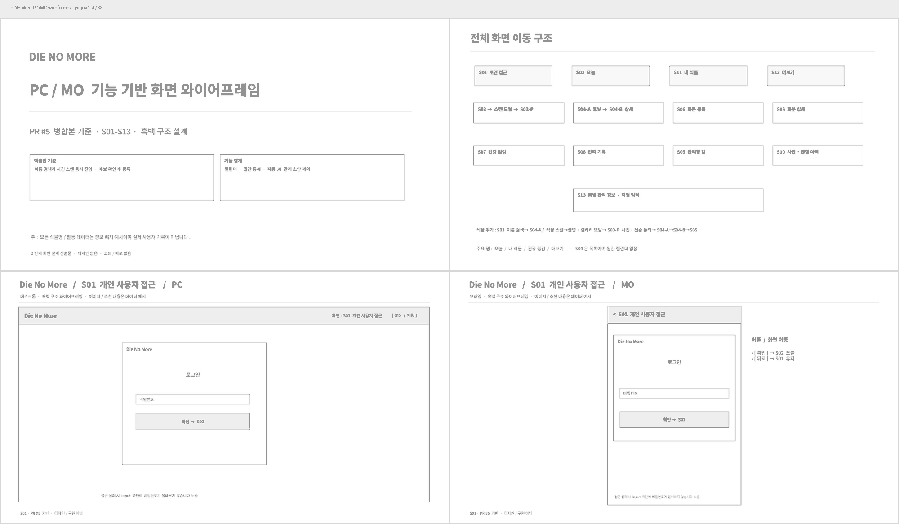 | 5–8쪽 · 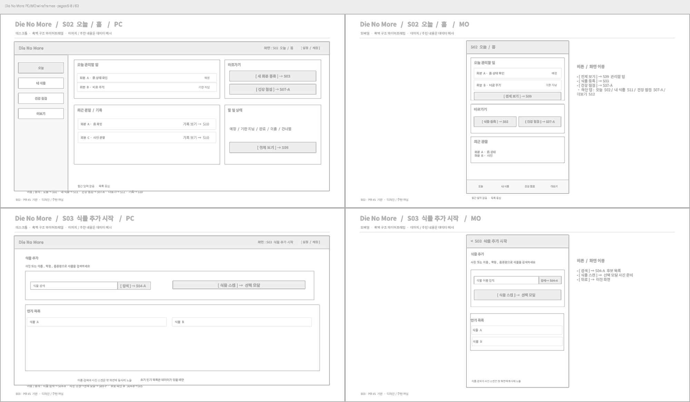 |
| 9–12쪽 · 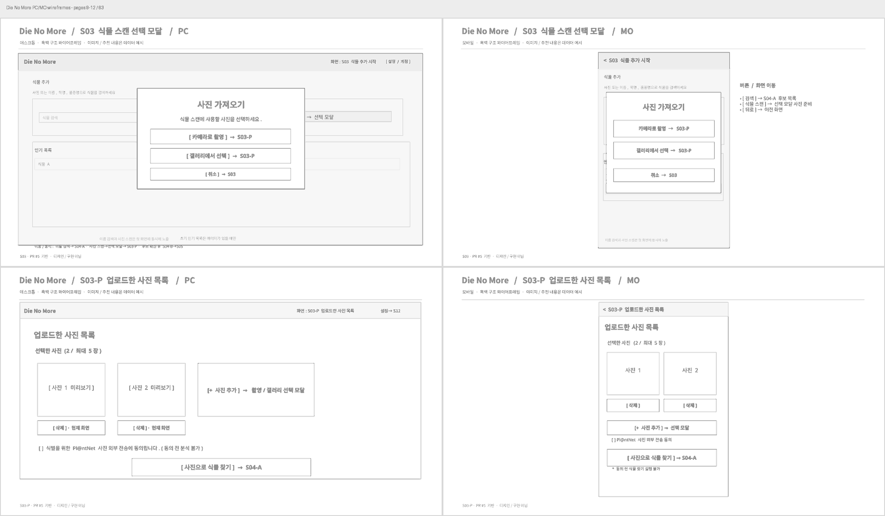 | 13–16쪽 · 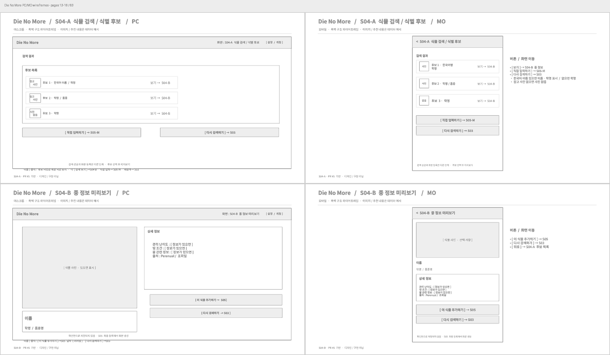 |
| 17–20쪽 · 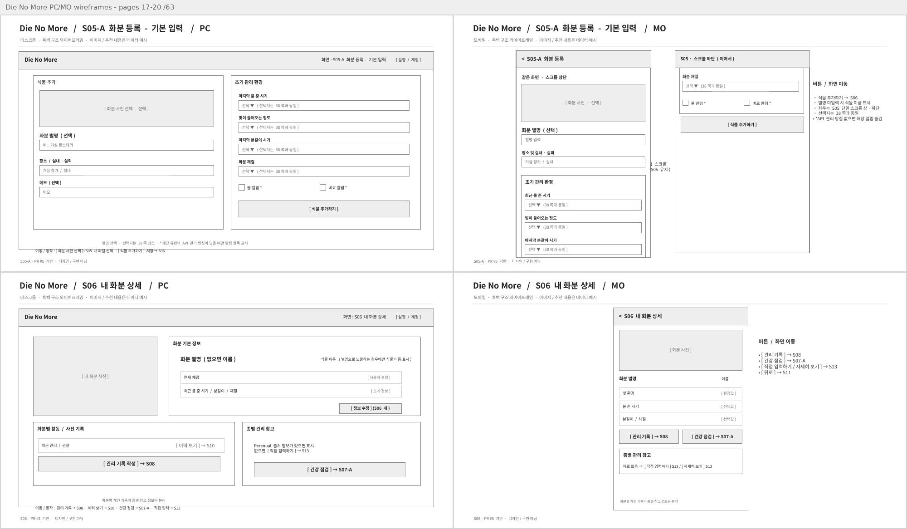 | 21–24쪽 · 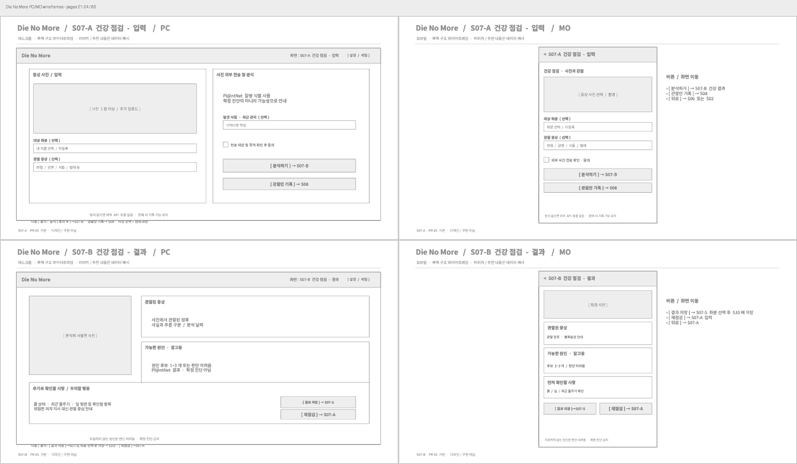 |
| 25–28쪽 · 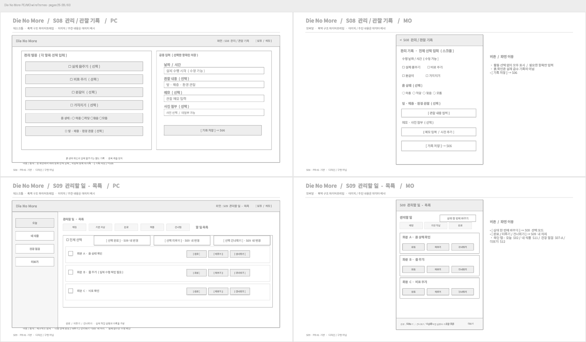 | 29–32쪽 · 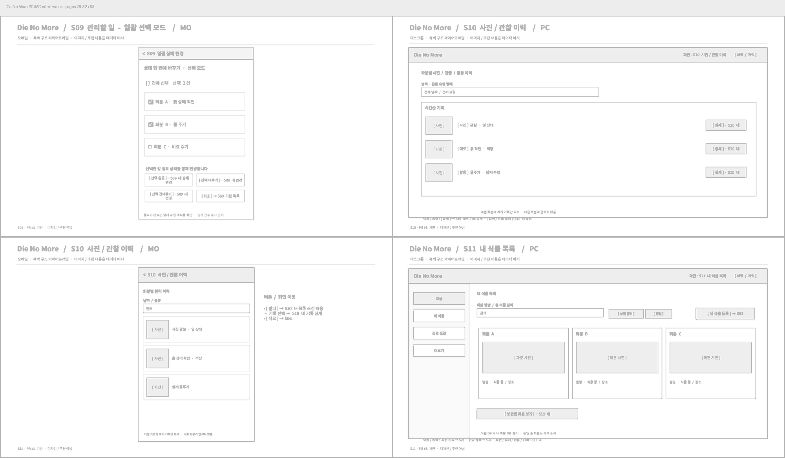 |
| 33–36쪽 · 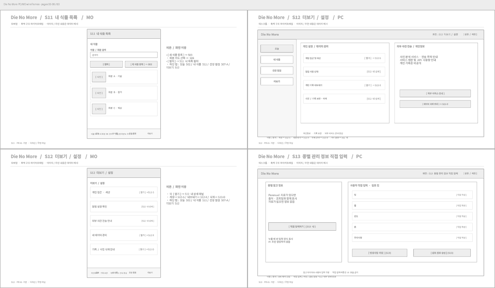 | 37–40쪽 · 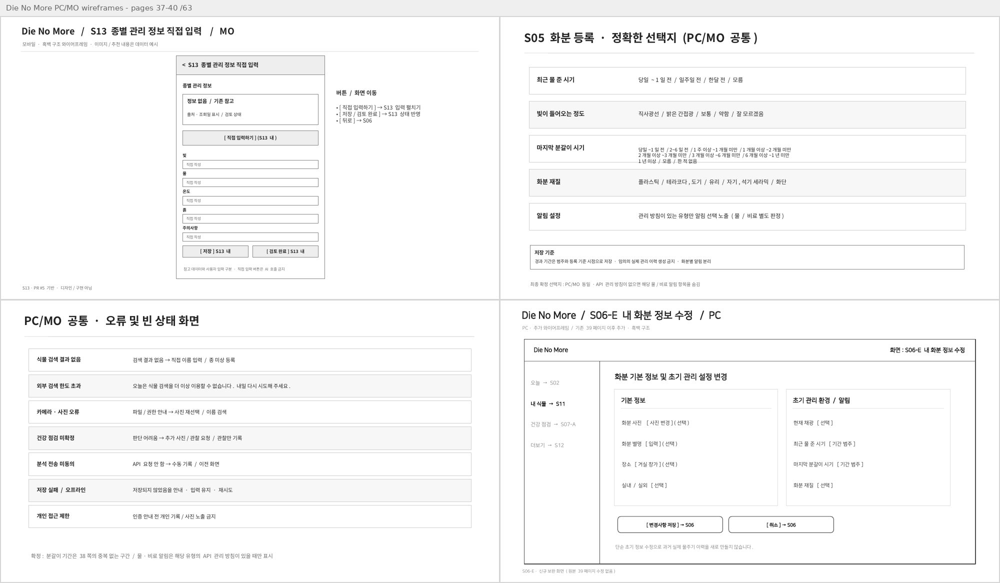 |
| 41–44쪽 · 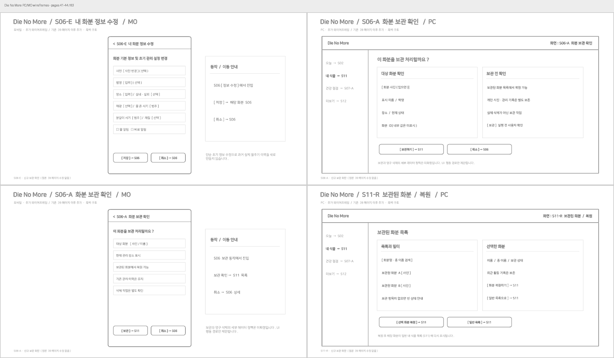 | 45–48쪽 · 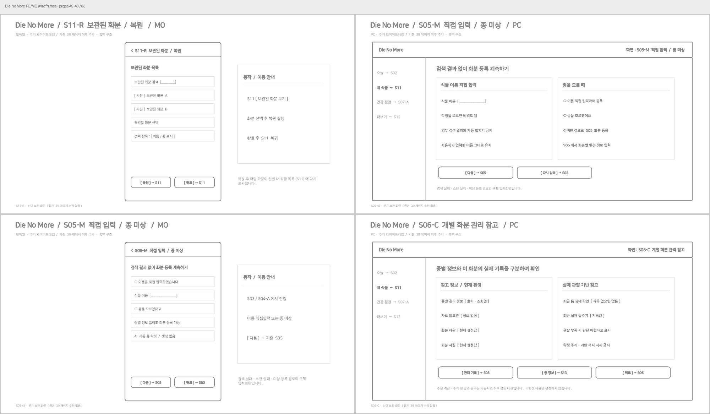 |
| 49–52쪽 · 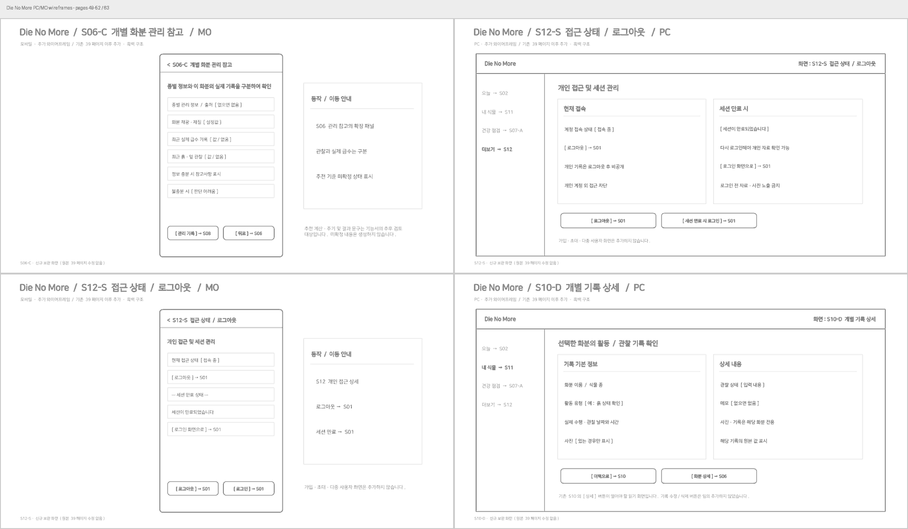 | 53–56쪽 · 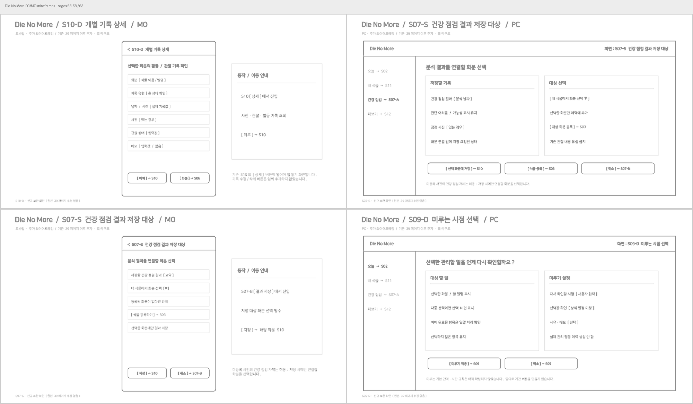 |
| 57–60쪽 · 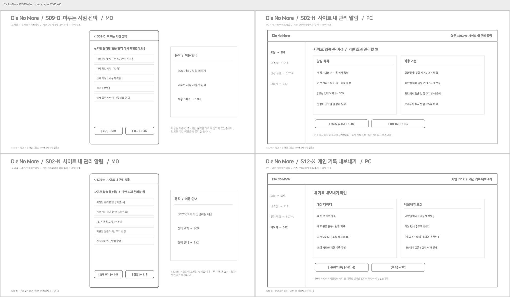 | 61–63쪽 · 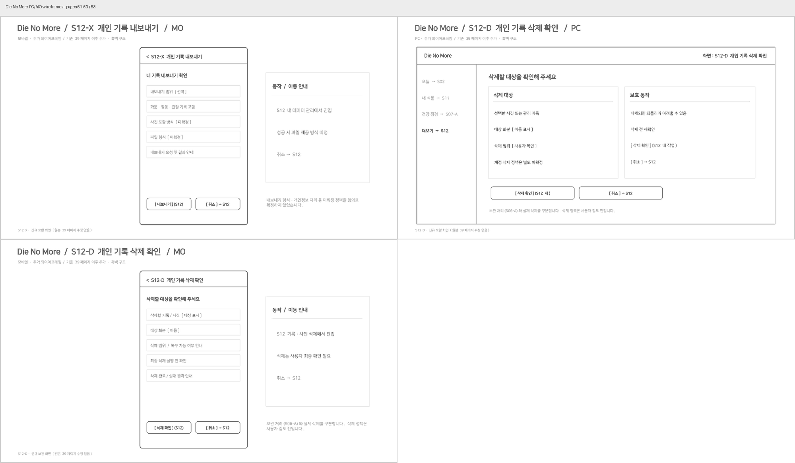 |

## 전체 화면 목록

| 페이지 | 환경 | 화면과 이동 |
|---|---|---|
| 1–2 | 공통 | 표지 · 전체 이동 구조 |
| 3–4 | PC/MO | S01 개인 사용자 접근 |
| 5–6 | PC/MO | S02 오늘/홈, 할 일 상태 및 S09 진입 |
| 7–8 | PC/MO | S03 식물 추가: 이름 검색과 식물 스캔 병렬 |
| 9–10 | PC/MO | S03 촬영/갤러리 선택 모달 |
| 11–12 | PC/MO | S03-P 업로드 사진 목록: 1~5장, 개별 삭제·추가, Pl@ntNet 전송 동의, [사진으로 식물 찾기] → S04-A |
| 13–14 | PC/MO | S04-A 후보: 사진(제공 시)·한국어 이름(확인된 경우)·학명, [보기] → S04-B, [직접 입력하기] → S05-M |
| 15–16 | PC/MO | S04-B 종별 정보 확인, [이 식물 추가하기] → S05 |
| 17–18 | PC/MO | S05 화분 등록: 별명 선택·초기 환경·기간 범주·알림 입력, 최종 저장 → S06 |
| 19–20 | PC/MO | S06 내 화분 상세 |
| 21–22 | PC/MO | S07-A 건강 점검 입력: 증상·사진·전송 확인 |
| 23–24 | PC/MO | S07-B 건강 결과: [결과 저장] → S07-S |
| 25–26 | PC/MO | S08 물주기·비료·분갈이·가지치기·관찰 통합 선택 입력 |
| 27 | PC | S09 관리할 일 목록, 체크박스 상시 노출 및 전체 선택 옆 일괄 변경 |
| 28–29 | MO | S09 기본 목록 및 [상태 한 번에 바꾸기] 선택 모드 |
| 30–31 | PC/MO | S10 화분별 사진·관찰·관리 이력 |
| 32–33 | PC/MO | S11 내 식물 목록 |
| 34–35 | PC/MO | S12 더보기, 로그아웃·내보내기·삭제 하위 화면 연결 |
| 36–37 | PC/MO | S13 종별 관리 정보 직접 입력 및 사용자 검토 |
| 38–39 | 공통 | S05 선택지 / 오류·빈 상태 |
| 40–41 | PC/MO | S06-E 내 화분 정보 수정 |
| 42–43 | PC/MO | S06-A 화분 보관 확인 |
| 44–45 | PC/MO | S11-R 보관 화분 목록·복원 |
| 46–47 | PC/MO | S05-M 이름 직접 입력·종 미상 등록, 다음 → S05 |
| 48–49 | PC/MO | S06-C 개별 화분 관리 참고 |
| 50–51 | PC/MO | S12-S 접근 상태·로그아웃 |
| 52–53 | PC/MO | S10-D 개별 이력 상세 |
| 54–55 | PC/MO | S07-S 건강 결과 저장 대상 선택·저장 → 해당 화분 S10 |
| 56–57 | PC/MO | S09-D 미루는 시점 선택 후 S09 복귀 |
| 58–59 | PC/MO | S02-N 사이트 내 관리 알림 |
| 60–61 | PC/MO | S12-X 기록 내보내기 |
| 62–63 | PC/MO | S12-D 개인 기록 영구 삭제 확인 |

## 확정된 화면 이동

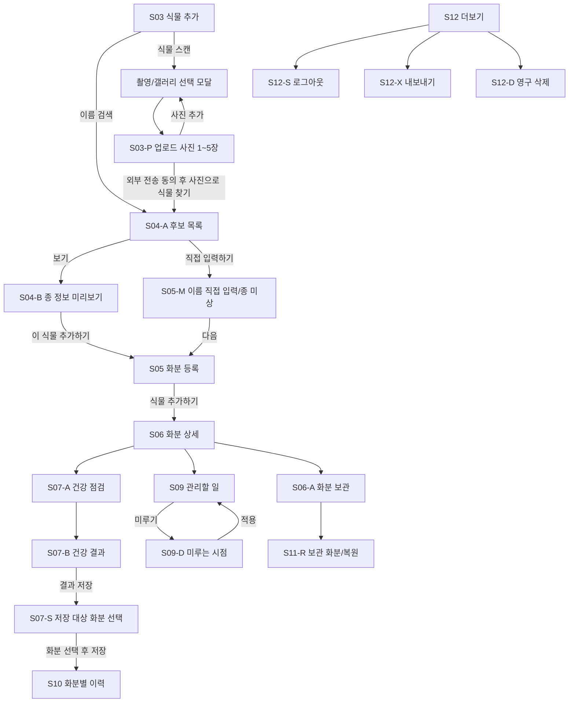

**사진 식별:** S03 [식물 스캔]에서 촬영·갤러리 선택 모달을 먼저 연다. S03-P에서는 업로드 사진 확인·추가·삭제만 수행하며, 분석은 [사진으로 식물 찾기]로 시작해 S04-A 후보 목록에 표시한다. 최신 63페이지 화면의 **S03-P 외부 사진 전송 동의 확인**을 유지한다.

**사진 후보:** PC/MO 모두 확인된 한국어 이름(있을 때)·학명 및 제공되는 참고 사진(있을 때)을 표시한다. 없는 이름·사진을 임의 생성하지 않는다.

**건강 결과 저장:** S07-B의 [결과 저장]은 항상 S07-S로 이동하고, 대상 화분을 선택한 후 해당 화분의 이력(S10)에 저장한다. 연결되지 않은 상태에서는 저장하지 않는다.

**PC/MO 일괄 관리:** PC S09는 체크박스를 항상 노출하고 [전체 선택] 옆에 일괄 완료·미루기·건너뛰기 버튼을 배치한다. 모바일 S09는 상단 [상태 한 번에 바꾸기]로 선택 모드에 진입한다. 두 화면은 동일한 상태 변경을 수행한다.

## 사용자 확정 운영 규칙 (2026-11-11)

다음 여섯 항목은 추가 검토용 제안이 아니라 **사용자가 직접 채택한 최종 결정**이다.

### 1. S05 마지막 분갈이 경과 기간

서로 겹치지 않도록 선택지와 경계를 다음으로 통일한다.

| 선택지 | 범위 |
|---|---|
| 당일~1일 전 | 등록일 당일 또는 1일 전 |
| 2~6일 전 | 2일 이상 7일 미만 |
| 1주 이상~1개월 미만 | 7일 이상, 1개월 미만 |
| 1개월 이상~2개월 미만 | 1개월 이상, 2개월 미만 |
| 2개월 이상~3개월 미만 | 2개월 이상, 3개월 미만 |
| 3개월 이상~6개월 미만 | 3개월 이상, 6개월 미만 |
| 6개월 이상~1년 미만 | 6개월 이상, 1년 미만 |
| 1년 이상 | 1년 이상 |
| 모름 | 정확한 시기를 알 수 없음 |
| 한 적 없음 | 사용자가 분갈이한 이력이 없음 |

**저장 규칙:** 사용자가 고른 경과 범주와 등록 기준 시점을 보존한다. 선택값을 임의의 정확한 분갈이 날짜 또는 실제 분갈이 이력으로 변환하지 않는다.

### 2. 물·비료 알림 (S05, S06, S02-N, S09)

- 식물DB에 연결된 관리 정보 API에 해당 종의 **물주기 또는 비료 주기 데이터**가 있으면, S05에서 해당 알림의 사용 여부를 체크할 수 있도록 표시한다.
- 해당 유형의 데이터가 없으면 그 알림 항목은 노출하지 않는다. 두 유형 모두 없으면 알림 선택 영역을 숨긴다.
- 알림 사용 여부는 화분별로 저장하며, S02-N과 S09에는 켜진 알림의 할 일만 반영한다.
- 알림의 시점·주기 산출 규칙은 보류 중이다. 확정 전까지 고정 주기나 자동 생성 지시를 만들지 않는다.
- 실제 흙 상태 확인과 실제 물주기 수행은 구분하며, 알림만으로 물주기 이력을 생성하지 않는다.

### 3. 미루기 간격 (S09-D)

- 기본 선택: **1일 후**
- 빠른 선택: **3일 후**, **7일 후**
- 별도 선택: **날짜 직접 지정**
- 개별 또는 다중 선택한 관리할 일에 적용한다. 미루기는 실제 수행이 아니므로 물주기·비료 등 수행 이력을 만들지 않는다.

### 4. 화분 보관·복원과 영구 삭제 (S06-A, S11-R, S12-D)

- **보관:** 화분과 관련 관리 기록·사진을 유지하고 활성 관리 대상에서 제외한다. 이후 사용자가 보관된 화분 목록에서 복원할 수 있다.
- **복원:** 저장된 화분과 이력을 유지한 채 활성 상태로 되돌린다.
- **영구 삭제:** 삭제 대상과 영향을 받는 기록·사진을 명확히 보여주고 사용자에게 재확인을 받는다. 확정 시 해당 화분의 개인 정보·관리 이력·개인 사진을 삭제하며 복원할 수 없다.
- 보관과 삭제를 같은 동작으로 취급하지 않는다. 종별 공통 참고 정보와 화분별 개인 이력은 분리하여 처리한다.

### 5. 기록 내보내기 (S12-X)

- 사용자 화분 및 관리·관찰 기록을 **JSON과 CSV 형식**으로 제공한다.
- **ZIP 파일** 안에 데이터 파일을 포함하고, 사용자가 선택하면 관련 **사진 파일도 함께 포함**한다.
- 사진은 포함하지 않는 선택도 가능하다. 내보내기에는 개인 기록만 담으며 다른 화분·계정 데이터가 섞이지 않도록 한다.

### 6. 건강 점검 결과 저장 (S07-B → S07-S → S10)

- **S07-S에서 저장 대상 화분 선택이 필수**다. 선택 전에는 저장하지 않는다.
- 해당 화분의 이력에 **분석 결과, 사진 참조, 분석 시각, 사용자가 입력한 증상, 가능한 원인 후보, 불확실성 정보**를 함께 저장한다.
- 확정 진단으로 표현하지 않으며, 저장 후 해당 화분의 **S10 이력**에서 확인한다.
- 미등록 식물의 건강 점검은 할 수 있지만, 결과 저장 전에는 대상 화분 선택 또는 등록이 필요하다.

## 적용 범위

이 PR에는 **63페이지 기존 와이어프레임의 원본 PPTX·PDF와 이미지 미리보기** 및 확정 규칙을 함께 담았다. 위 여섯 가지 운영 규칙은 기존 이미지에 남아 있는 오래된 예시 선택지·미정 표기보다 우선한다. **기존 슬라이드를 임의로 재배치하거나 수정한 것은 아니며**, 사용자가 확정한 규칙을 문서로 명시한 것이다.

이 PR은 화면 설계 단계의 산출물이다. 코드 구현, API 호출, DB 마이그레이션, 테스트 실행, 배포, PR 병합은 포함되지 않는다.
